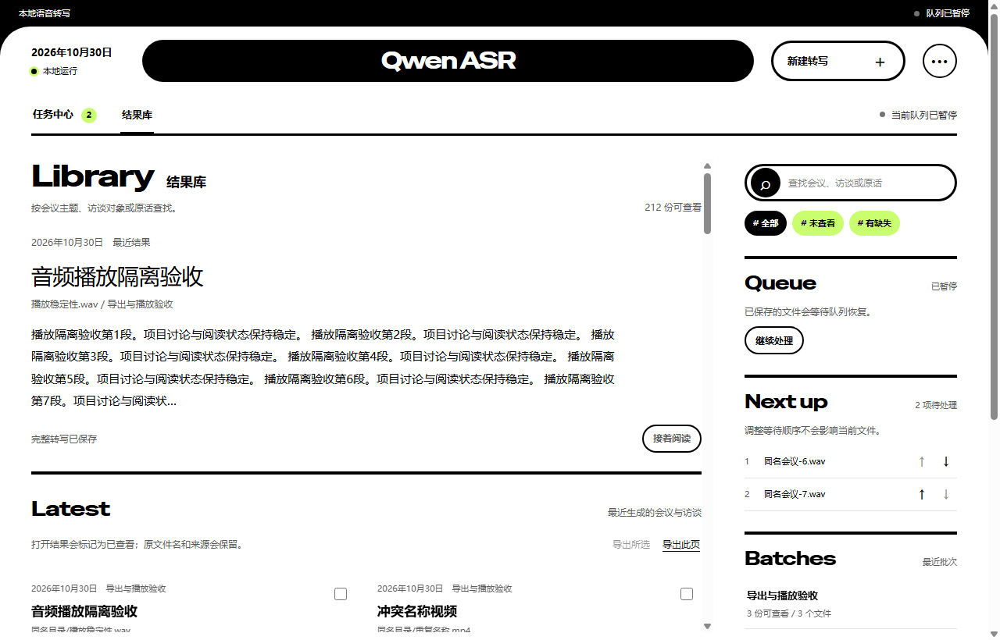
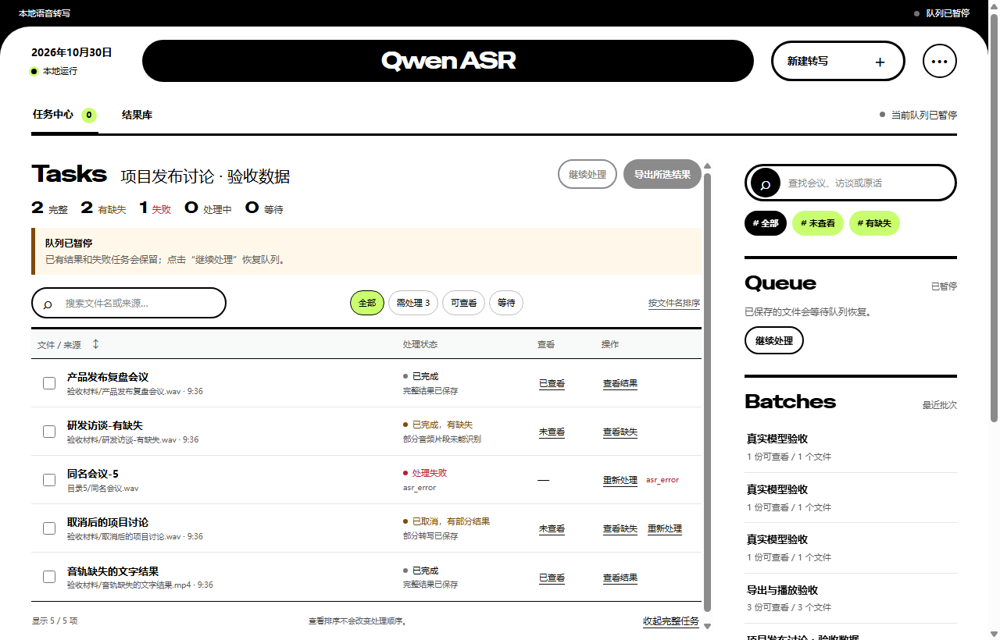
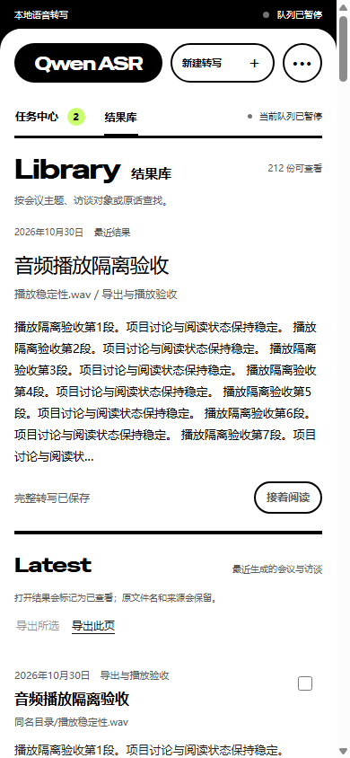
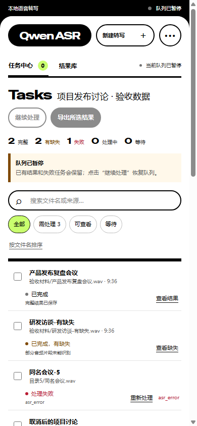

# Gizmodo v1 实现验收记录

日期：2026-10-30。分支：`feat/gizmodo-workspace`。

**结论：未通过整体验收。** 黑白绿视觉基础、批次组织与主要队列接口已落地，真实模型转写、暂停、取消及后台阅读隔离可以工作；仍有 11 组与设计要求不符的问题，其中 5 组涉及导入内容丢失、结果查看、列表一致性或数据恢复，应优先修复。

对照依据为 [设计方案](../../design/gizmodo-v1/README.md) 第 2–6 节及同目录设计图。本报告的截图来自运行中的应用生产构建，不使用初稿页面代替应用验收。

## 运行方式与证据范围

- 使用项目缓存指定的解释器 `E:\anaconda3\envs\qwen3asr\python.exe`，实际版本 **Python 3.12.13**；`environment.yml` 声明的是 3.13。原先全局 `python` 指向 3.15，不能代表本项目的运行环境。
- 将当前后端源码及 `frontend/dist` 复制到 `build/acceptance-20261030/runtime`，使用独立数据目录，在 `127.0.0.1:8765` 启动实际 FastAPI 程序。模型和二进制使用原项目文件。关键源码及生产资源一致性见 [代码快照](code-snapshot.json)。
- 使用本机无界面 Chrome 检查 1280×820、960×820、390×844、640×820，以及 1280×420。640 CSS px 只作为 1280 窗口放大 200% 后的重排等效检查，不表示已检查桌面 WebView2 的真实缩放。
- 初始使用 205 份旧格式历史、4 份完整/部分/取消/媒体缺失记录及 3 份导出和播放记录，均为虚构验收数据。真实转写使用 Windows Zira 合成的 10.272 秒英语音频；取消使用其拼接后的约 82 秒版本。
- 现有用户数据未用于导入、删除或取消操作。本次创建的后台、模型和 Chrome 进程已关闭。

### 启动阻塞及本次唯一业务代码修正

初次在项目解释器中导入后端失败：`HistoryStore.batches(self) -> list[dict]` 的 `list` 被同一类中较早定义的 `list()` 方法遮蔽，抛出 `TypeError: 'function' object is not subscriptable`。Python 3.15 上的 `py_compile` 没有暴露这个运行时注解问题。

已在 [backend/history.py](../../../backend/history.py#L9) 添加 `from __future__ import annotations`，之后实际启动和测试能够继续。以下验收针对该修正后的代码。其余发现保留为待修问题，没有在验收过程中扩大实现范围。

## 已通过的主要项目

| 项目 | 实际证据 |
| --- | --- |
| 白底、黑色胶囊品牌、荧光绿筛选、真实本地展示字体 | 实际页面使用 Special Gothic Expanded One；页面网络记录没有外部资源依赖。见 [布局记录](probe.json)、[交互记录](ui.json)。 |
| 响应式基本重排 | 1280、960、390 和 640 CSS px 下未发现页面横向溢出。窄屏操作入口的位置另列为问题。 |
| 后端准备状态、模型和能力接口 | 实际模型启动并预热；`/api/readiness`、`/api/health`、`/api/limits`、搜索和批次接口返回成功。 |
| 真实上传 → 队列 → 识别 → 历史持久化 | 两份真实音频完成；第一份得到完整英语文本，约 1.83 秒处理 10.272 秒音频。见 [运行记录](live.json)。 |
| 阅读与后台处理隔离 | 读 A 时 B 完成，阅读 DOM 和 audio 元素保持同一实例，查找词保持“项目”，暂停的播放位置保持 3 秒。 |
| 协作取消、暂停及原文件重试 | 当前文件取消后有部分历史；后续任务保持 queued；取消项重试接口成功。 |
| 查询全部历史、保存查看状态、旧结果完整性兼容 | 可查到 200 份之外的记录；阅读位置持久化接口及旧版取消状态测试通过。手机页面滚动保存另列为问题。 |
| 查看排序与队列调度分离 | 切换表格排序前后，后端等待队列 ID 顺序不变。 |
| 文件夹相对来源、部分上传回执 | 带 `webkitRelativePath` 的同名文件分别保留；第二项超出大小上限时，第一项成功回执和队列状态正确。普通文件选择入口另列为问题。 |
| 失败和取消项不会被完成清理删除 | 直接存储测试通过，取消项暂存文件仍可用。 |
| 部分结果默认排除、ZIP 有效性 | 默认导出排除部分结果；实际 ZIP CRC 正确，包含导出清单。重名清单路径另列为问题。 |
| 对话框基本键盘流程及缺失媒体回退 | 背景 inert、Tab 焦点约束、Escape 关闭通过；缺失音轨时正文仍可读。 |

## 未通过项

### A01 · P1：普通文件选择仍会静默丢弃同名同大小文件

设计要求不同目录的同名同大小文件分别保留，且不能仅凭名称和大小判定内容相同。实际给文件选择器传入两个名称相同、长度相同、内容不同的 File 后，导入清单只剩 **1 项**；带不同相对路径的文件夹入口则保留 2 项。

原因：无 `webkitRelativePath` 时退回 `file.name`，随后以 `path + size` 去重。见 [Workspace.tsx](../../../frontend/src/Workspace.tsx#L345)、[复现截图](07-import-duplicate-loss.png)、[交互结果](ui.json)。

修正方向：普通选择器的来源不明时保留每个 File，或使用用户可确认的来源身份；不凭名称和大小静默过滤。

### A02 · P1：按文件名/标题搜索后，打开结果会显示空正文

搜索“历史验收记录-000”正确返回一份历史，打开后记录有 6 段正文，页面却显示 **0 条字幕行**。全局搜索词被自动写入文内查找框，再用于过滤全部正文；当命中来自标题、来源或批次时，正文不一定包含该词。

见 [Workspace.tsx](../../../frontend/src/Workspace.tsx#L227)、[空正文截图](08-title-search-empty-reader.png)、[交互结果](ui.json)。

修正方向：区分标题/来源命中和正文命中；只有正文命中才初始化文内定位。查找无命中时仍应有明确反馈和可见全文入口。

### A03 · P1：加载更多后返回清单会重复追加同一页

结果库加载两页共 **72 条**，打开一份结果再返回，页面变为 **108 条，唯一结果仍为 72 条**。返回使查询 effect 再执行，而非零 offset 总是向已有数组追加。

见 [Workspace.tsx](../../../frontend/src/Workspace.tsx#L207)、[运行记录](live.json)。

修正方向：按页保存并替换相应分页，或回访时恢复已有分页缓存；合并时按稳定结果 ID 去重。不能把重新请求相同 offset 当作新增页。

### A04 · P1：保存失败后，已有文字不可读，重试来源也被删除

对 worker 注入“有 text，但 `history_id=None`”的保存失败返回，队列虽然标为 `history_save_failed`，仍走完成流程并删除暂存文件。没有历史记录可打开，队列行也没有重试入口，不能兑现设计中的“结果暂可读但未持久化”。

见 [queue_api.py](../../../backend/queue_api.py#L347)、[验收用例](checks_backend.py#L72)、[失败结果](workspace-tests.xml)。此外，页面完整数只按 done 和完整性统计，没有要求存在可用 history_id，保存失败项仍可能计入“完整”。见 [Workspace.tsx](../../../frontend/src/Workspace.tsx#L415)。

修正方向：保留可回收的临时结果或原文件，提供保存重试/重新处理，并从可长期回访的成功数中排除保存失败项。

### A05 · P1：查看旧版可能把旧版变成批次中的“最新版”

同一任务在同一秒生成版本 1 和版本 2，随后更新版本 1 的查看位置，批次摘要会返回版本 1。历史文件先按 mtime 排序，查看位置又更新 mtime；随后按秒级 created_at 排序，时间相同会保留错误的先后，再按 task_id 去重。

见 [history.py](../../../backend/history.py#L273)、[验收用例](checks_backend.py#L82)、[失败结果](workspace-tests.xml)。

修正方向：每个 task_id 以持久化的 result_version 选择版本，不能用文件修改时间表达结果生成顺序。

### A06 · P2：结果库不会随后台新结果完成自动更新

停留在结果库时完成真实任务 C，后端总数从 213 变为 **214**，页面仍显示 **213 份可查看**。批次 effect 订阅队列 version，结果查询 effect 未订阅结果完成事件或版本变化。

见 [Workspace.tsx](../../../frontend/src/Workspace.tsx#L207)、[截图](13-library-stale-count.png)、[运行记录](live.json)。

修正方向：在结果完成时更新结果库及其总数，保留当前筛选、加载范围和阅读隔离。

### A07 · P2：窄屏搜索/批次不可便捷访问，整页滚动不保存阅读位置

- 390×844 下，搜索入口距页面顶部约 **8325px**，批次入口约 **8762px**。没有设计要求的窄屏可展开入口，必须滚完整份结果列表才能访问。
- 阅读页在手机使用 window 滚动，保存监听却只绑定 main；滚到 **2500px** 并等待后，后端 `read_position` 仍为 **0**。

见 [index.css](../../../frontend/src/index.css#L20)、[Workspace.tsx](../../../frontend/src/Workspace.tsx#L551)、[交互记录](ui.json)、[运行记录](live.json)。

修正方向：将搜索/批次做成靠近导航的窄屏面板；按当前实际滚动容器监听并恢复位置。

### A08 · P2：ZIP 重名文件有效，但清单路径与包内文件不一致

`重复名称.wav` 和 `重复名称.mp4` 导出 TXT 后，实际包内正确生成 `重复名称.txt` 和 `重复名称_2.txt`，但 manifest 的两条 included 都写成 `重复名称.txt`。清单在 ZIP 内部重名处理之前生成，没有使用最终文件名。

见 [Workspace.tsx](../../../frontend/src/Workspace.tsx#L77)、[manifest 生成](../../../frontend/src/Workspace.tsx#L470)、[解包校验](zip.json)。默认排除部分结果的案例通过，文件本身 CRC 也通过。

修正方向：先确定最终包内路径，再用同一映射生成文件和清单；冲突后缀应稳定。

### A09 · P2：字号、触控区与任务滚动布局偏离规范

- 任务状态实测 **11px**，来源/辅助信息 **10px**；手机有 **9px** 辅助信息。设计规定重要状态不低于 13px。
- 手机“查看结果”“重新处理”等操作高度实测 **28px**，低于约 44px 的主要触控目标。
- 阅读正文桌面 **17px**、手机 **15px**，未达到方案的 18px / 1.9。
- 任务页页头仍为 **88px**，未压缩到约 68px；主栏和任务清单均设内部滚动。1280×420 下表格从 **y=419px** 才开始，几乎没有可见任务行，未实现过矮窗口切整页滚动。

见 [布局记录](probe.json)、[边界记录](edge.json)、[任务手机截图](16-tasks-mobile.png)、[矮窗口截图](15-tasks-short-window.png)、[样式](../../../frontend/src/index.css#L15)。

### A10 · P2：部分明确要求的交互尚未实现

运行复现：请求词级时间戳后关闭并重开导入框，选项恢复为 false，未沿用上次设置；无匹配查询显示“还没有转写结果”和新建入口，没有清除筛选入口。

代码对照还未见：结果库紧凑列表与偏好保存、阅读段落/字幕行切换、未完成任务的详情入口、暂停导入后需恢复队列的明确提示，以及桌面退出中断文件将从头处理的说明。

见 [Workspace.tsx](../../../frontend/src/Workspace.tsx#L364)、[无匹配截图](09-search-empty-state.png)、[交互记录](ui.json)。这些属于方案现有交互要求，不属于真实波形、高级检索等可选增强。

### A11 · P2：未开启对齐时，实际时间戳能力没有如实说明

真实 10.272 秒音频未请求对齐时，后端保存了全文，但 `segment_count=0`、`segments=[]`；阅读页没有时间行，却仍显示“时间戳来自转写结果”。SRT 导出通过现有回退逻辑产生覆盖整段音频的 **1 个 cue**，全文没有丢失，但它不能表达分段定位能力。

见 [运行记录](live.json)、[边界记录](edge.json)、[真实结果截图](17-real-no-alignment-result.png)、[Workspace.tsx](../../../frontend/src/Workspace.tsx#L670)。

修正方向：区分词级、段级、整段粗略回退和无时间戳；不把全文结果描述为已有分段时间信息。

## 测试结果与覆盖边界

| 检查 | 结果 |
| --- | --- |
| 原有后端测试 | **95 passed**，见 [JUnit](baseline-tests.xml)。首次边跑模型边测试时有一项 8080 端口干扰；关闭验收服务后完整复跑通过。 |
| 本次新增的后端验收用例 | **7 passed / 2 failed**。失败对应 A04、A05。见 [用例](checks_backend.py)、[JUnit](workspace-tests.xml)。 |
| 浏览器交互与真实模型流程 | 原始记录为 [ui.json](ui.json)、[live.json](live.json)、[edge.json](edge.json)。失败项已逐项解释，不以编译成功代替行为验收。 |
| 布局和资源记录 | [probe.json](probe.json)，其中截图/布局采集成功不代表所有设计规范通过，应结合 A07、A09。 |
| ZIP 实际内容 | [zip.json](zip.json)，包含文件名、CRC 和 manifest 路径一致性。 |

未完成覆盖：桌面 WebView2 外壳的真实关窗/退出行为、真实浏览器 200% 缩放、完整辅助技术及所有文字对比度审计、真实 GPU 强制对齐全过程、长视频完整转写及识别准确率。GPU 对齐器“可用”仅由实际健康接口确认，没有将其等同于已验证词级对齐质量。

## 实际截图

| 桌面结果库 | 桌面任务中心 |
| --- | --- |
|  |  |

| 手机结果库 | 手机任务中心 |
| --- | --- |
|  |  |

本报告保留未通过项，供后续修改与复验使用；本轮没有提交或推送。
